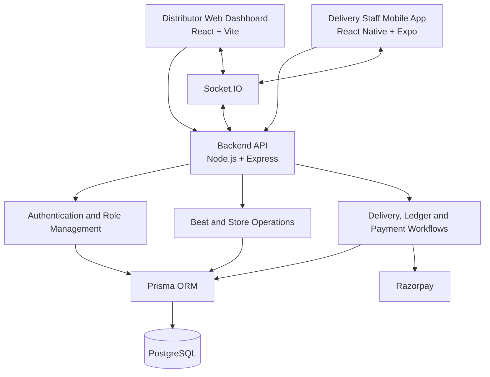

# BeatSync

BeatSync is a distributor operations and delivery management platform that connects a distributor's web dashboard with a mobile application for delivery staff. It helps teams plan daily store visits, manage deliveries and payments, and keep track of store accounts.

## Problem

Distributors often coordinate store visits, delivery staff, orders, collections, returns, and outstanding balances across separate tools or manual processes. This makes daily planning harder and limits visibility into field operations.

## Solution

BeatSync brings these workflows together:

- **Daily beat planning:** Generate a daily store-visit plan using factors such as visit recency, outstanding balances, overdue days, delivery-staff workload, and locality.
- **Team assignment:** Review, reassign, and publish beats for delivery staff.
- **Delivery workflow:** Let delivery staff view their assigned beat, access store details, record delivered items, and complete visits.
- **Payments and returns:** Record collections, manage returns, and support payment verification through Razorpay.
- **Store account visibility:** Track store ledgers, outstanding amounts, and promised credit payments.
- **Operations dashboard:** View store and delivery metrics, completed-visit progress, cash collected, team information, and stores that may need attention.
- **Live updates:** Use Socket.IO to keep relevant operational information synchronized.

## How It Works

1. A distributor signs in to the web dashboard and manages stores and delivery operations.
2. The system generates a proposed daily beat based on store and workload information.
3. The distributor reviews the plan, makes any required changes, and publishes it.
4. Delivery staff sign in to the mobile app and view their assigned visits.
5. During each visit, staff record delivery items, payments, returns, or follow-up details.
6. The dashboard provides visibility into progress and store account activity.

## Architecture



## Main Features

### Daily Beat Management
- Generate a daily visit plan for active stores.
- Account for visit recency, outstanding balance, overdue days, staff workload, and locality.
- Allow the distributor to review, reassign, and publish the plan.

### Delivery Staff App
- Role-based delivery staff access.
- View assigned beats and daily summaries.
- Open store visit details and manage visit status.
- Add, update, or remove delivery items.
- Record payments, returns, and credit-promise details.

### Distributor Dashboard
- Monitor total stores and completed visits.
- Track cash collected and delivery progress.
- View delivery staff and operational alerts.
- Identify stores with high outstanding balances.
- Navigate to store ledger information.

### Payments
- Create and verify payment orders through Razorpay.
- Keep payment-related actions within the delivery workflow.

## Tech Stack

| Area | Technologies |
|---|---|
| Web dashboard | React 19, Vite, React Router, Zustand |
| UI and charts | Tailwind CSS, Lucide React, Recharts |
| Mobile application | React Native, Expo, Expo Router |
| Mobile navigation and storage | React Navigation, AsyncStorage |
| Backend | Node.js, Express 5 |
| Database and ORM | PostgreSQL, Prisma |
| Authentication | JWT, bcrypt, Google authentication |
| Real-time communication | Socket.IO |
| Payments | Razorpay |

## Repository Structure

```text
beatsync/
├── backend/
│   ├── prisma/              # Database schema and Prisma configuration
│   └── src/
│       ├── controllers/
│       ├── middleware/
│       ├── routes/
│       ├── app.js
│       └── server.js
└── frontend/
    ├── src/                 # React web dashboard
    │   ├── pages/
    │   ├── components/
    │   └── ...
    └── BeatSync/            # React Native / Expo mobile app
        ├── app/
        └── ...
```

## Getting Started

The repository contains separate projects for the backend, web dashboard, and mobile app. Install dependencies in each project directory before running it.

### Prerequisites

- Node.js and npm
- PostgreSQL
- Expo Go or an Android/iOS development environment for the mobile app
- Razorpay credentials if testing payment flows
- Google authentication configuration if testing Google sign-in

### 1. Clone the Repository

```bash
git clone https://github.com/VGSAIRAIMA/beatsync.git
cd beatsync
```

### 2. Start the Backend

```bash
cd backend
npm install
```

Configure the environment variables required by the backend, including the PostgreSQL connection and any authentication, Google sign-in, and Razorpay settings used by your local configuration. Do not commit secrets.

Generate the Prisma client and apply the database migrations according to the Prisma configuration in the repository, then start the server:

```bash
npx prisma generate
npx prisma migrate dev
npm run dev
```

### 3. Start the Web Dashboard

In a separate terminal:

```bash
cd frontend
npm install
npm run dev
```

Configure the frontend's API endpoint to point to your running backend, as required by the project configuration.

### 4. Start the Mobile App

In another terminal:

```bash
cd frontend/BeatSync
npm install
npx expo start
```

Use the Expo development tools to run the app on a simulator, emulator, or supported device. Ensure the app is configured to reach the backend from that device.

> **Configuration note:** Environment variable names and deployment-specific values should be taken from the project's configuration files. Keep API keys, database credentials, JWT secrets, and payment credentials out of source control.

## Notes

- BeatSync includes a web dashboard for distributor-side operations and a mobile app for delivery staff.
- Payment processing depends on valid Razorpay configuration.
- Google sign-in depends on the corresponding OAuth/client configuration.
- The mobile app must be able to reach the backend over the network; a device cannot generally use a computer's `localhost` address to reach the backend running on that computer.

---

